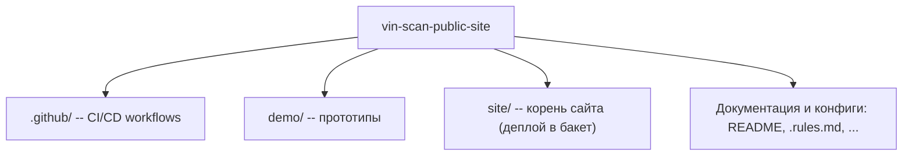

# Vin-Scan

Публичный сайт сервиса: https://vin-scan.ru

Сайт лежит в `site/`: эта папка выгружается в бакет и служит корнем для абсолютных путей `/css/...`, `/js/...` и `/img/...`.

Поэтому в HTML пути начинаются с `/` и при переносе в `site/` не меняются: `/css/base.css` в браузере превращается в `site/css/base.css` на диске и в `css/base.css` в бакете. Добавлять `site/` в `href` и `src` нельзя -- на проде такого пути нет.

## Структура репозитория



```text
vin-scan-public-site/
├── .github/workflows/
│   ├── deploy.yml            валидация HTML и синхронизация site/ с Yandex Object Storage
│   └── auto-format.yml       автоформатирование через .editorconfig
├── demo/                     локальные HTML/CSS-заготовки секций
├── site/                     публикуемый корень сайта
│   ├── index.html            главная страница (хаб со всеми секциями)
│   ├── how/                  как это работает
│   ├── photo-sts/            подбор по фото СТС и ПТС
│   ├── vin/                  подбор по VIN-коду
│   ├── integrations/         интеграции (ABCP)
│   ├── solutions/            решения для бизнеса
│   ├── pricing/              тарифы
│   ├── pilot/                условия пилота
│   ├── faq/                  вопросы и ответы
│   ├── contacts/             контакты и форма заявки
│   ├── consent/              согласие на обработку ПД
│   ├── privacy/              политика конфиденциальности
│   ├── css/                  стили (base, layout, blocks, components, legal)
│   ├── js/                   клиентские скрипты (FAQ, слайдер, форма, шапка, метрика, статус сервиса)
│   ├── img/                  векторные и растровые ассеты, логотипы, чат, партнёры
│   ├── favicon.svg           векторная иконка сайта
│   ├── site.webmanifest      манифест PWA
│   ├── robots.txt            инструкции для поисковиков
│   └── sitemap.xml           карта сайта
├── .rules.md                 правила разработки, ограничения HTML и CSS-архитектура
└── README.md
```

## Страницы сайта

Каждая страница лежит в `site/<имя>/index.html` и имеет собственные `title`, `description`, `canonical`, Open Graph и один `h1`. Главная страница остаётся хабом: каждая её секция ведёт по ссылке «Подробнее» на отдельную страницу.

| Адрес | Назначение |
|---|---|
| `/` | Главная: обзор сервиса, форма заявки (`/#apply`) |
| `/how/` | Как это работает |
| `/photo-sts/` | Подбор по фото СТС и ПТС |
| `/vin/` | Подбор по VIN-коду |
| `/integrations/` | Интеграции (ABCP) |
| `/solutions/` | Решения для бизнеса |
| `/pricing/` | Тарифы |
| `/pilot/` | Условия пилота |
| `/faq/` | Вопросы и ответы (разметка `FAQPage`) |
| `/contacts/` | Контакты и форма заявки |
| `/privacy/`, `/consent/` | Юридические документы |

Страницы отдаются со слэшем на конце. Бакет редиректит `/pricing` на `/pricing/`, поэтому `canonical`, внутренние ссылки и [sitemap.xml](site/sitemap.xml) используют только вариант со слэшем. Якорь формы заявки вне главной пишется как `/#apply`.

### Шапка и подвал

Шапка, подвал и cookie-плашка одинаковы на всех страницах, кроме `/privacy/` и `/consent/` (у них отдельная вёрстка в `legal.css`). Общего include нет, поэтому любое изменение шапки или подвала нужно внести во все `site/**/index.html`, кроме юридических страниц.

### Подключение стилей

Главная: `base.css` → `header.css` → `page.css` → `chat-slider.css` → `blocks.css` → `faq.css` → `apply.css` → `footer.css` → `cookie.css`.

Внутренние страницы: `base.css` → `header.css` → `page.css` → [`chat-slider.css`] → `blocks.css` → [`faq.css`] → [`apply.css`] → `inner.css` → `footer.css` → `cookie.css`. В скобках файлы, которые подключаются только там, где нужны. Стили внутренних страниц (хлебные крошки, первый экран, текст, таблица тарифов, плашка-призыв) лежат в [site/css/blocks/inner.css](site/css/blocks/inner.css).

Юридические страницы: `base.css` → `legal.css` → `cookie.css`. Файл `legal.css` переопределяет `body`, `.container`, `h1` и `footer`, поэтому подключать его на страницы с общей шапкой и подвалом нельзя.

### Как добавить новую страницу

1. Создайте `site/<имя>/index.html`, скопировав шапку, подвал и cookie-плашку с любой внутренней страницы.
2. Заполните уникальные `title`, `description`, `canonical` (со слэшем), `og:*` и один `h1`. Добавьте JSON-LD (`BreadcrumbList` и тип, подходящий странице).
3. Добавьте ссылку на страницу в шапку и подвал всех страниц.
4. Добавьте адрес в [site/sitemap.xml](site/sitemap.xml) и обновите `lastmod`.
5. Запустите проверку HTML (см. раздел «Форматирование и валидация HTML»).

## SEO

- У каждой страницы свои `title`, `description`, `canonical` и Open Graph / Twitter Cards.
- Микроразметка Schema.org (JSON-LD): `Organization`, `WebSite`, `SoftwareApplication` на главной, `BreadcrumbList` на внутренних страницах, `FAQPage` на `/faq/`.
- [site/sitemap.xml](site/sitemap.xml) содержит все публичные страницы со слэшем на конце, [site/robots.txt](site/robots.txt) ссылается на него.
- Показатели скорости и точности, которые указаны на сайте («до 30 с», «−70%», «95%»), приводятся только с оговоркой «внутреннее тестирование».

## Логотип компании

Логотипы компании лежат в папке [site/img/](site/img/). Для анимации шестерёнки в шапке и подвале логотип разделён на неподвижную основу [`site/img/logo_header.svg`](site/img/logo_header.svg) и вращающийся слой [`site/img/logo_gear.svg`](site/img/logo_gear.svg); цельный [`site/img/logo_full.svg`](site/img/logo_full.svg) остаётся как базовый векторный оригинал.

## Изображения

Логотипы партнёров и прочие изображения хранятся в WebP с шириной до 480 px. Логотипы сайта и обложка остаются в SVG / PNG.

## Стили и правила разработки

Подробное руководство по стилям, палитре, ховерам, брейкпоинтам и ограничениям HTML вынесено в документ [.rules.md](.rules.md). **Убедительная просьба соблюдать правила оттуда.**

## Кеширование

[`.github/workflows/deploy.yml`](.github/workflows/deploy.yml) отдаёт все файлы с `Cache-Control: no-cache, must-revalidate`: браузер хранит копию, но перед каждым использованием проверяет её на сервере. Если файл не менялся, приходит `304 Not Modified` без тела ответа. Поэтому после деплоя никто не видит старую вёрстку, а повторные визиты не перекачивают стили, скрипты и картинки заново.

## Деплой

Для деплоя используется [deploy.yml](.github/workflows/deploy.yml). При push в `main` он проверяет HTML и выгружает сайт в Yandex Object Storage, при pull request выполняется только проверка. Ручной запуск доступен через `workflow_dispatch`.

В бакет выгружается содержимое [site/](site/): это корень сайта. [`README.md`](README.md), [`.editorconfig`](.editorconfig), [`.htmlvalidate.json`](.htmlvalidate.json), папка [demo/](demo/) и прочее остаются в репозитории.

> [!important]
> Флаг `--delete` удаляет из бакета всё, чего нет в `site/`, поэтому любые файлы, загруженные отдельно, нужно хранить внутри `site/` или убрать этот флаг.

### Локальный просмотр

Запускайте сервер из папки `site/`, иначе абсолютные пути `/css/...` и `/img/...` не найдутся:
```sh
cd site
python3 -m http.server 8000
```

## Форматирование и валидация HTML

Для форматирования используется [.gitattributes](.gitattributes) и [.editorconfig](.editorconfig) ([auto-format.yml](.github/workflows/auto-format.yml) создаёт дополнительный коммит `style: auto-format via '.editorconfig'` при необходимости, подробнее на [editorconfig.org](https://editorconfig.org/)).

Для валидации HTML реализуется через шаг `validate` в [deploy.yml](.github/workflows/deploy.yml), блокирующей push / PR в случае ошибок вёрстки (подробнее [html-validate](https://html-validate.org/)).

Валидатор отклоняет пуш или PR в следующих случаях:
- не закрыты или некорректно вложены теги
- нарушена базовая структура HTML-документа
- использованы inline-стили через атрибут `style="..."`
- использованы блоки стилей через тег `<style>...</style>`

Конфигурация проверки находится в [.htmlvalidate.json](.htmlvalidate.json).

Запустить проверку локально можно командой:

```sh
npx --yes html-validate@11.16.2 "site/**/*.html"
```

## Яндекс Метрика

Счётчик Яндекс Метрики вынесен в отдельный файл [site/js/metrika.js](site/js/metrika.js) и подключается в секции `<head>` одной строкой:

```html
<script src="/js/metrika.js" defer></script>
```
